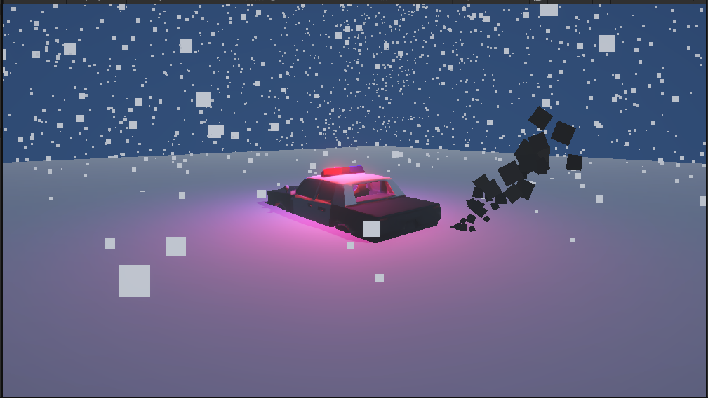

# Escena Invernal de Rescate

Taller de laboratorio de Unity 3D: composición de escenas y control de transformaciones.

| | |
|---|---|
| **Estudiante** | Sebastian Rey Escobar |
| **Código** | 2610344 |
| **Curso** | 750126M-01 Desarrollo de Videojuegos-01 |
| **Motor** | Unity 6000.3.26f1 (Universal Render Pipeline) |

## Descripción

Una patrulla de policía quedó atrapada y semienterrada en una tormenta de nieve. El motor sigue encendido y emite humo, las luces de emergencia giran sin parar y la nevada cubre toda la escena.

La escena combina modelo 3D, iluminación, un script de rotación y dos sistemas de partículas.



## Jerarquía de la escena

```
Main Camera
Moon_Light
Snow_Terrain
Police_Car
├── Car_Mesh
├── Siren_Pivot          (script SirenRotation)
│   ├── Red_Light
│   └── Blue_Light
└── Exhaust_Smoke
Global_Blizzard
```

| # | Objeto | Componente principal | Función |
|---|---|---|---|
| 1 | `Main Camera` | Camera | Encuadre diagonal del coche |
| 2 | `Moon_Light` | Directional Light | Luz de luna azul pálida, intensidad baja |
| 3 | `Snow_Terrain` | Plane | Suelo con material de nieve |
| 4 | `Police_Car` | Empty Object | Objeto padre, hundido en Y = -0.6 |
| 5 | `Car_Mesh` | Modelo 3D (FBX) | Carrocería de la patrulla |
| 6 | `Siren_Pivot` | Empty Object | Pivote del techo, contiene el script |
| 7 | `Red_Light` | Point Light | Luz roja de la sirena |
| 8 | `Blue_Light` | Point Light | Luz azul de la sirena, lado opuesto |
| 9 | `Exhaust_Smoke` | Particle System | Humo del escape |
| 10 | `Global_Blizzard` | Particle System | Nevada sobre toda la escena |

## Script: `SirenRotation.cs`

Está en `Assets/Scripts/` y se asigna únicamente a `Siren_Pivot`. Hace girar el pivote sobre su eje Y, y con él las luces roja y azul.

- La variable pública `rotationSpeed` (grados por segundo) se ajusta desde el Inspector.
- Usa `Transform.Rotate()` en `Update()`, multiplicado por `Time.deltaTime`, para que la velocidad no dependa de los fotogramas por segundo.

## Sistemas de partículas

**`Global_Blizzard` (nieve)**
- Shape Box emitido desde el cielo hacia abajo.
- Velocidad inicial variable, gravedad moderada y ruido para simular viento.
- Color blanco con un ligero tono azul claro.

**`Exhaust_Smoke` (humo del escape)**
- Shape Cone muy estrecho, ubicado en la parte trasera del coche.
- Color over Lifetime: de gris oscuro a transparente.
- Size over Lifetime: el tamaño crece con el tiempo.

## Cómo abrir el proyecto

1. Instala Unity Hub y el editor **6000.3.26f1**.
2. Clona el repositorio:
   ```bash
   git clone git@github.com:EvilandAoki/Unity-Taller-Invierno-REY.git
   ```
3. Agrega la carpeta del proyecto en Unity Hub y ábrela.
4. Abre la escena `Assets/Scenes/WinterRescue.unity` y pulsa Play.

## Estructura del repositorio

```
Assets/
├── Materials/     Materiales de nieve y partículas
├── Models/        Modelo FBX de la patrulla
├── Scenes/        WinterRescue.unity
└── Scripts/       SirenRotation.cs
Screenshots/       Capturas de la escena
```

## Historial de commits

1. `feat: configuracion inicial del proyecto y escena vacia`
2. `feat: agregar terreno nevado y coche enterrado`
3. `feat: jerarquia de luces y sirenas de emergencia`
4. `feat: implementar script SirenRotation.cs`
5. `feat: integrar particulas de nieve y humo de escape`

## Créditos

- Modelo 3D de la patrulla generado con [Tripo](https://www.tripo3d.ai/).
